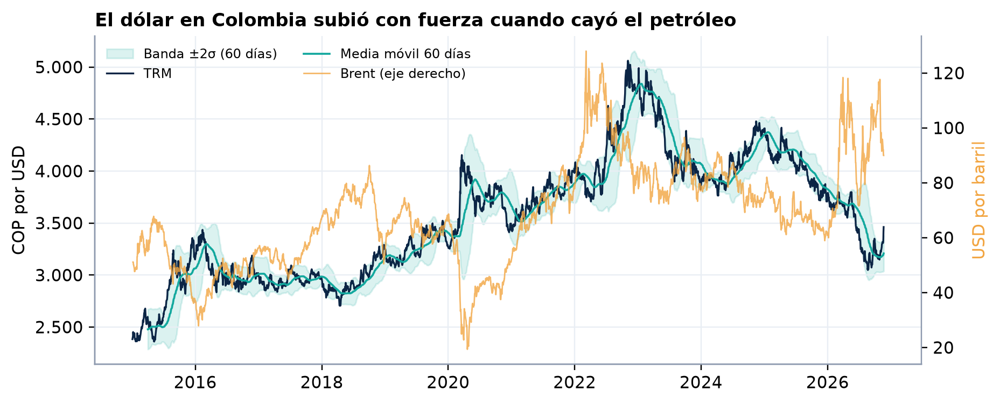
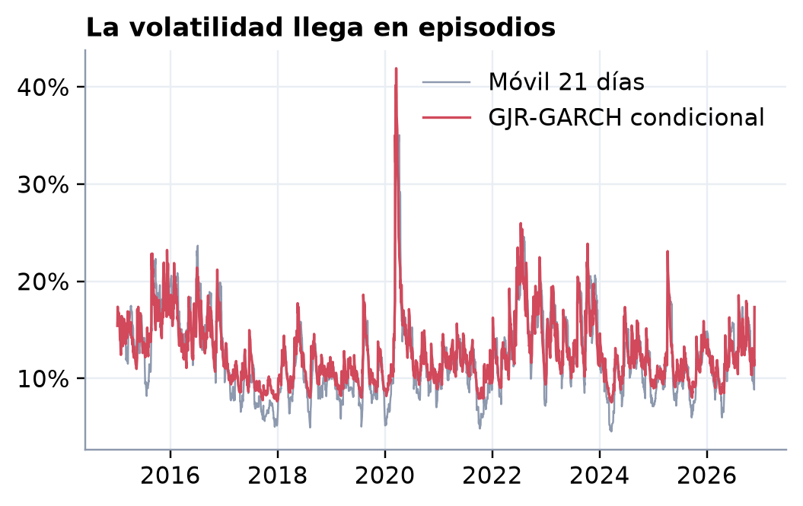
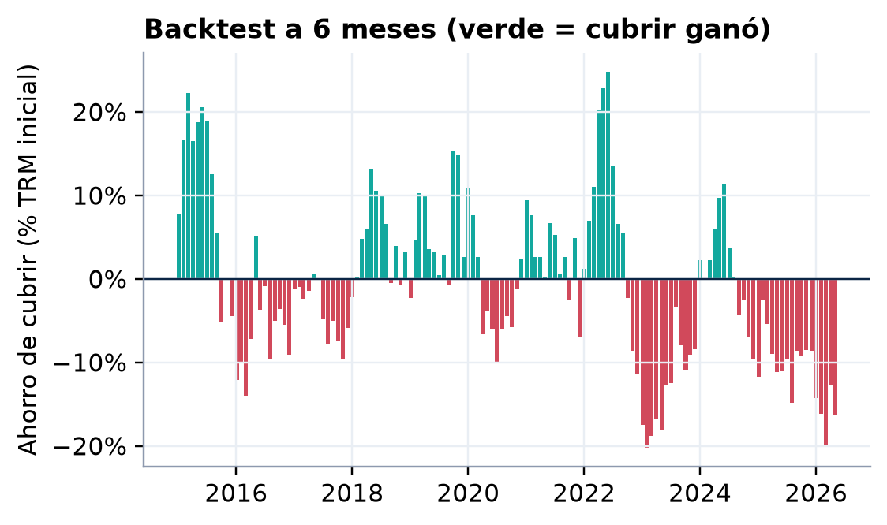
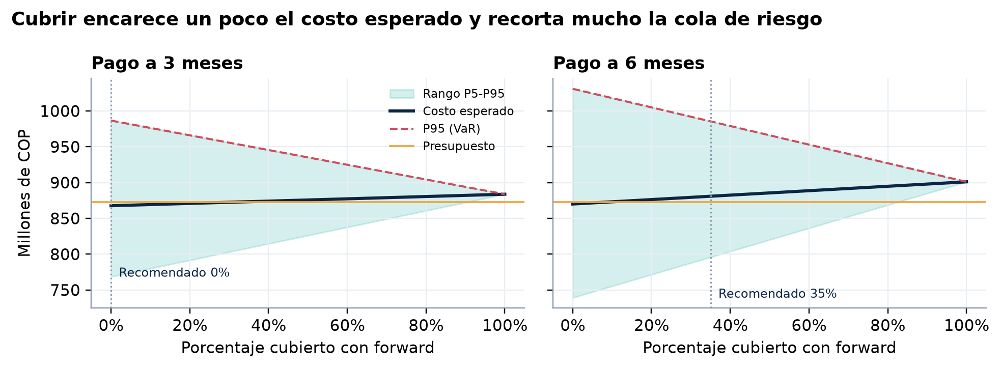
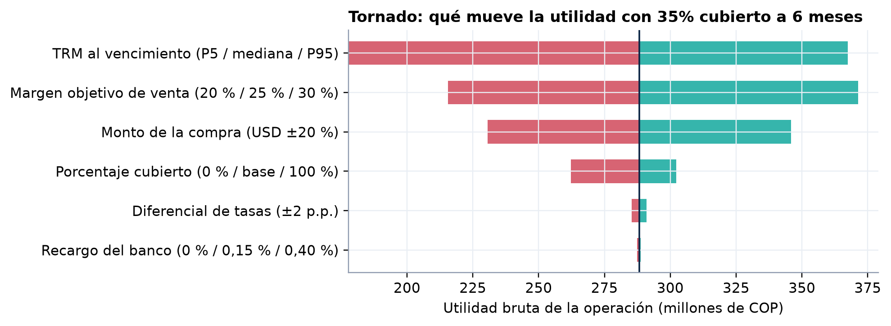

```{python}
## Carga de los resultados generados por el notebook y formatos de cifras
import json
import pandas as pd
from IPython.display import Markdown

with open("../resultados/resultados.json", encoding="utf-8") as archivo:
    R = json.load(archivo)

M, E, G, RG, S = R["mercado"], R["eda"], R["garch"], R["regresion"], R["supuestos"]


class Texto(str):
    """Texto que Quarto inserta como markdown, sin comillas ni escapes."""
    def _repr_markdown_(self):
        return str(self)


def num(valor, dec=0):
    """Número con punto de miles y coma decimal."""
    return f"{valor:,.{dec}f}".replace(",", "X").replace(".", ",").replace("X", ".")


def cop(valor, dec=0):
    return Texto("$\u00a0" + num(valor, dec))


def mill(valor, dec=1):
    return Texto("$\u00a0" + num(valor / 1e6, dec) + "\u00a0millones")


def pct(valor, dec=1):
    return Texto(num(valor * 100, dec) + "\u00a0%")


opt3, opt6 = R["optimas"]["3"], R["optimas"]["6"]
est = pd.DataFrame(R["estrategias"])
sin6 = est[(est.plazo == 6) & (est.cobertura == 0)].iloc[0]
sin3 = est[(est.plazo == 3) & (est.cobertura == 0)].iloc[0]
sim = pd.DataFrame(R["simulacion"])
base3 = sim[(sim.plazo == 3) & (sim.deriva == "Paseo aleatorio")].iloc[0]
base6 = sim[(sim.plazo == 6) & (sim.deriva == "Paseo aleatorio")].iloc[0]
val = pd.DataFrame(R["validacion"])
sens = pd.DataFrame(R["sensibilidad_deriva"])
bt = pd.DataFrame(R["backtest"]).set_index("plazo")
tor = pd.DataFrame(R["tornado"])
tend6 = sens[(sens.deriva == "Tendencia histórica") & (sens.plazo == 6)].iloc[0]
tend3 = sens[(sens.deriva == "Tendencia histórica") & (sens.plazo == 3)].iloc[0]
fecha = pd.Timestamp(M["fecha_decision"])
meses = ["enero", "febrero", "marzo", "abril", "mayo", "junio", "julio", "agosto",
         "septiembre", "octubre", "noviembre", "diciembre"]
fecha_txt = f"{fecha.day} de {meses[fecha.month - 1]} de {fecha.year}"
```

```{python}
#| output: asis
## Portada con las cifras clave de la decisión
tarjetas = [
    ("TRM vigente", cop(M["spot"], 2), fecha_txt),
    ("Forward a 6 meses", cop(M["forward_6"], 2), f"{pct(M['forward_6'] / M['spot'] - 1)} sobre la TRM"),
    ("Cobertura sugerida a 6 meses", pct(opt6["cobertura"], 0), "del pago al proveedor"),
    ("Costo en el peor 5 %", f"−{mill(sin6['costo_p95'] - opt6['costo_p95'])}", "frente a no cubrir"),
]
celdas = ",\n".join(
    f'tarjeta("{t}", "{v}", "{d}")' for t, v, d in tarjetas)
cerca = "`" * 3
print(f"""
{cerca}{{=typst}}
#portada(
  "Cobertura cambiaria USD/COP para una importadora de Cartagena",
  "¿Conviene fijar hoy el dólar de los pagos a 3 y 6 meses, y en qué proporción?",
  "Angel Vega Rodríguez · Germán De Armas · María Valentina Serna · Luis Mario Díaz",
  "Toma de decisiones basadas en datos · Universidad Tecnológica de Bolívar · Noviembre de 2026",
)
#grid(columns: (1fr, 1fr, 1fr, 1fr), gutter: 8pt,
{celdas}
)
{cerca}
""")
```

```{=typst}
#heading(level: 1)[1. El problema y la decisión]
```

Una importadora mediana de Cartagena paga a sus proveedores del exterior en dólares y vende en pesos. Cuando hace un pedido fija el precio de venta con un margen bruto del `{python} pct(S["margen_objetivo"], 0)` sobre el costo calculado con la TRM presupuestada, pero el pago se hace tres o seis meses después. Si en ese tiempo el dólar sube, la compra se encarece y el margen se reduce sin que la empresa pueda trasladar el aumento. La gerencia considera inaceptable un margen inferior al `{python} pct(S["margen_minimo"], 0)`.

La empresa tiene tres caminos. Puede no cubrirse y pagar a la TRM del vencimiento, puede fijar hoy toda la tasa con un forward de compra de dólares, o puede cubrir solo una parte. La pregunta que guía el análisis es **si conviene cubrir la compra que se paga dentro de 3 o de 6 meses y qué porcentaje del monto**, teniendo en cuenta el riesgo del dólar y su relación con el petróleo y las tasas de interés.

La empresa es hipotética porque las estadísticas de importaciones del DANE no se publican por empresa. Se supone un pago de `{python} "US$ " + num(S["monto_usd"])` por pedido. La TRM presupuestada es el promedio de los últimos 12 meses (`{python} cop(M["presupuesto"], 2)`). El banco cobra un recargo de `{python} pct(S["margen_banco"], 2)` sobre el forward teórico. La empresa acepta como máximo un `{python} pct(S["tolerancia_riesgo"], 0)` de probabilidad de quedar por debajo del margen mínimo. Todos estos valores se pueden cambiar en el tablero.

| Métrica | Qué mide | Para qué sirve |
|:--|:--|:--|
| Costo esperado en COP | Promedio del costo de la compra en 10.000 escenarios | Comparar cuánto cuesta en promedio cada estrategia |
| Desviación frente al presupuesto | Costo esperado menos el costo presupuestado | Saber si la estrategia respeta el plan financiero |
| Probabilidad de superar el presupuesto | Proporción de escenarios con costo mayor al presupuesto | Medir la probabilidad de pérdida cambiaria |
| Percentil 95 (VaR) y CVaR | Costo en el peor 5 % de los escenarios | Dimensionar el daño en un mal escenario |
| Probabilidad de margen bajo | Proporción de escenarios con margen bajo el mínimo | Regla de decisión, ligada a la meta del negocio |
| Ahorro esperado | Costo esperado sin cubrir menos costo con cobertura | Precio que se paga por la protección |

## 2. Datos y preparación

```{python}
#| output: asis
D = R["datos"]
print(f"""
| Fuente | Series | Uso |
|:--|:--|:--|
| Superfinanciera en datos.gov.co | TRM oficial diaria, {num(D['obs_trm'])} datos entre {D['inicio'][:4]} y {D['fin'][:4]} | Tasa con la que se liquida la compra |
| Yahoo Finance | USD/COP de mercado, Brent, WTI, índice dólar, Ecopetrol, S&P 500, oro | Factores externos y contraste de la TRM |
| Banco de Pagos Internacionales | Tasas de política de BanRep y la Fed, inflación de Colombia y EE. UU. | Precio del forward y contexto macro |
""")
```

Las descargas se hacen por código y se guardan en CSV para que el análisis no dependa de que las fuentes respondan. La TRM llegó sin duplicados ni nulos y sus únicos saltos diarios mayores al 4 % son de marzo de 2020, por lo que se conservan. La serie `COP=X` de Yahoo, en cambio, tenía `{python} D["atipicos_yahoo"]` cotizaciones imposibles o alejadas más de 3 % de la TRM, que se marcaron como faltantes. Los mercados de Colombia y EE. UU. no cierran los mismos días, así que todo se alineó con el calendario de la TRM y las relaciones entre variables se midieron con retornos semanales (`{python} D["semanas"]` semanas). FRED bloqueó la descarga automática y se reemplazó por el BIS, que publica las mismas tasas.

## 3. Lo que muestran los datos

Entre 2015 y 2026 el dólar se movió entre `{python} cop(E["trm_min"], 0)` y `{python} cop(E["trm_max"], 0)` (noviembre de 2022). Su volatilidad anual es de `{python} pct(E["vol_anual"])`, pero en periodos de 21 días llegó a `{python} pct(E["vol_21d_max"], 0)` en marzo de 2020. Los retornos tienen colas más pesadas que una normal (curtosis en exceso de `{python} num(E["curtosis"], 1)`), lo que obliga a modelar escenarios extremos con más cuidado. La prueba de Kruskal-Wallis (p = `{python} num(E["kw_p"], 2)`) no encuentra estacionalidad por mes, así que no hay un mes “barato” para pagar.

{#fig-trm width=100%}

El peso se debilita cuando caen el petróleo y el apetito por riesgo. La correlación semanal de la TRM es `{python} num(E["corr_ecopetrol"], 2)` con Ecopetrol, `{python} num(E["corr_sp500"], 2)` con el S&P 500, `{python} num(E["corr_brent"], 2)` con el Brent y `{python} num(E["corr_dxy"], 2)` con el índice dólar. En la regresión de retornos semanales con errores robustos los tres factores son significativos al 1 %. Una subida de 10 % en el índice dólar se asocia con `{python} pct(RG["beta_dxy"] * 0.1)` más de TRM y una de 10 % en el Brent con `{python} pct(-RG["beta_brent"] * 0.1)` menos, pero el R² es de apenas `{python} num(RG["r2"], 2)`. La relación con el petróleo además es inestable (su correlación móvil de un año va de `{python} num(E["corr_movil_brent_min"], 2)` a `{python} num(E["corr_movil_brent_max"], 2)`), de modo que sirve para leer el contexto pero no para pronosticar el dólar.

Por eso la incertidumbre se modeló directamente con un **GJR-GARCH(1,1) con innovaciones t**. La persistencia es de `{python} num(G["persistencia"], 3)` y un choque tarda unos `{python} num(G["vida_media"], 0)` días hábiles en disiparse a la mitad. El término de asimetría es negativo y significativo (p = `{python} num(G["p_gamma"], 3)`), lo que indica que las subidas del dólar elevan más la volatilidad que las bajadas. Es justo el caso que perjudica al importador. Hoy la volatilidad condicional es de `{python} pct(G["vol_actual"])`, por encima de su promedio histórico.

::: {layout-ncol=2}
{#fig-vol}

{#fig-backtest}
:::

## 4. Evaluación de decisiones

**Precio del forward.** Se aproxima con la paridad cubierta de tasas, $F = S_0\,[(1+i_{COP})/(1+i_{USD})]^{T}(1+m)$. Con la tasa del Banco de la República en `{python} pct(M["tasa_cop"], 2)` y la de la Fed en `{python} pct(M["tasa_usd"], 2)`, el forward queda en `{python} cop(M["forward_3"], 2)` a 3 meses y `{python} cop(M["forward_6"], 2)` a 6 meses, ambos por encima del presupuesto. Cubrir no es gratis, cuesta el diferencial de tasas.

**Simulación Monte Carlo.** Con el GJR-GARCH se simularon `{python} num(R["n_sim"])` trayectorias diarias de la TRM con semilla fija (`{python} R["semilla"]`) y retorno esperado cero. El 90 % de los escenarios queda entre `{python} cop(base3["p5"])` y `{python} cop(base3["p95"])` a 3 meses y entre `{python} cop(base6["p5"])` y `{python} cop(base6["p95"])` a 6 meses. La probabilidad de que el dólar termine por encima del forward es `{python} pct(base3["prob_sobre_forward"], 0)` y `{python} pct(base6["prob_sobre_forward"], 0)`. Para validar, se repitió el ejercicio con el método de la clase, una distribución triangular con mínimo, valor más probable y máximo tomados de la historia. Su percentil 95 a 3 meses (`{python} cop(val.iloc[0]["p95"])`) es casi igual al del GARCH (`{python} cop(val.iloc[1]["p95"])`).

```{python}
#| output: asis
## Tabla de estrategias con las cifras de la simulación
filas = ["| Plazo | Cubierto | Costo esperado | Percentil 95 | P(superar presupuesto) | P(margen < mínimo) | Ahorro vs no cubrir |",
         "|:-:|:-:|--:|--:|:-:|:-:|--:|"]
for _, f in est.sort_values(["plazo", "cobertura"]).iterrows():
    filas.append(f"| {int(f.plazo)} meses | {pct(f.cobertura, 0)} | {mill(f.costo_esperado)} | {mill(f.costo_p95)} | "
                 f"{pct(f.prob_superar_presupuesto, 0)} | {pct(f.prob_margen_bajo)} | {mill(f.ahorro_esperado)} |")
print("\n".join(filas))
```

**Regla de decisión.** Siguiendo la lógica de fijar un umbral por su efecto económico, se elige la cobertura más barata que mantenga la probabilidad de un margen bajo el mínimo en `{python} pct(S["tolerancia_riesgo"], 0)` o menos. A 3 meses no hace falta cubrir, porque esa probabilidad ya es de `{python} pct(sin3["prob_margen_bajo"])`. A 6 meses sube a `{python} pct(sin6["prob_margen_bajo"])` y la regla indica cubrir el **`{python} pct(opt6["cobertura"], 0)`**. Con eso la probabilidad baja a `{python} pct(opt6["prob_margen_bajo"])` y el costo en el peor 5 % de los casos pasa de `{python} mill(sin6["costo_p95"])` a `{python} mill(opt6["costo_p95"])`, a cambio de `{python} mill(opt6["costo_esperado"] - sin6["costo_esperado"])` más de costo esperado.

{#fig-estrategias width=100%}

**Sensibilidad.** El tornado muestra que la TRM al vencimiento es la variable que más mueve la utilidad bruta (`{python} mill(tor.iloc[0]["rango"], 0)` entre el percentil 5 y el 95), seguida del margen de venta y del monto. El diferencial de tasas y el recargo del banco, que definen el precio del forward, casi no pesan. El riesgo está en el dólar y no en el costo de cubrirse. La recomendación sí depende de lo que se espere del dólar. Si se supone que sigue su tendencia histórica, la cobertura sugerida sube a `{python} pct(tend6["cobertura"], 0)` a 6 meses y `{python} pct(tend3["cobertura"], 0)` a 3 meses. Si se espera que suba al ritmo del diferencial de tasas, lo indicado es cubrir el 100 %.

{#fig-tornado width=68%}

**Backtest con datos reales.** Si la empresa hubiera cubierto el 100 % cada mes desde 2015, el forward habría salido más barato que esperar en el `{python} pct(bt.loc[6, "prob_cubrir_gano"], 0)` de los meses a 6 meses, con un costo promedio de apenas `{python} pct(-bt.loc[6, "ahorro_medio"], 2)` por dólar. A cambio, la dispersión del costo habría caído de `{python} pct(bt.loc[6, "desv_sin_cubrir"])` a `{python} pct(bt.loc[6, "desv_cubriendo"])` y se habría evitado el peor caso histórico, en el que no cubrir salió `{python} pct(bt.loc[6, "peor_sin_cubrir"], 0)` más caro que el forward.

## 5. Recomendación

La empresa debería **cubrir con forward entre el `{python} pct(opt6["cobertura"], 0)` y el `{python} pct(tend6["cobertura"], 0)` del pago a 6 meses** y dejar el resto a la TRM del vencimiento. Para los pagos a 3 meses la cobertura no es necesaria con los supuestos base, aunque cubrir hasta un `{python} pct(tend3["cobertura"], 0)` da margen si se espera que el dólar retome su tendencia. Esta combinación paga una prima pequeña y conocida para eliminar buena parte de la cola de riesgo, que es la que pone en peligro el margen. La decisión debe revisarse cada mes en el tablero. Conviene aumentar la cobertura si la volatilidad condicional sigue por encima del `{python} pct(E["vol_anual"], 0)` histórico, si el petróleo cae con fuerza o si la empresa exige un margen mínimo más alto. Si el diferencial de tasas se reduce, cubrir se vuelve más barato y la proporción puede subir sin mayor costo.


```{python}
#| output: asis
# Cobertura sugerida a 6 meses según el margen mínimo y la tolerancia, con el mismo código del tablero
import sys
sys.path.insert(0, "../dashboard")
from calculos import precio_forward, trm_simulada, curva_coberturas, cobertura_optima

sims = pd.read_csv("../dashboard/datos/simulaciones.csv")
f6 = precio_forward(M["spot"], M["tasa_cop"], M["tasa_usd"], 6, S["margen_banco"])
s6 = trm_simulada(sims["r_6m"].values, M["spot"], 0.0, M["pasos_6"])
minimos, tolerancias = [0.12, 0.15, 0.18, 0.20], [0.01, 0.05, 0.10]
filas = ["| Margen mínimo | " + " | ".join(f"Tolerancia {pct(t, 0)}" for t in tolerancias) + " |",
         "|:-:|" + ":-:|" * len(tolerancias)]
for mm in minimos:
    curva = curva_coberturas(s6, f6, monto_usd=S["monto_usd"], presupuesto=M["presupuesto"],
                             margen_objetivo=S["margen_objetivo"], margen_minimo=mm)
    celdas = [pct(cobertura_optima(curva, t)["cobertura"], 0) for t in tolerancias]
    filas.append(f"| {pct(mm, 0)} | " + " | ".join(celdas) + " |")
print("La regla responde a lo que la gerencia esté dispuesta a aceptar. La tabla muestra la cobertura sugerida a 6 meses al cambiar el margen mínimo y la tolerancia, con los demás supuestos en su valor base.\n")
print("\n".join(filas))
```

## 6. Limitaciones

El forward se aproximó con tasas de política monetaria y no con cotizaciones reales de un banco, que dependen del cliente y del plazo. La empresa y sus supuestos son hipotéticos. El GARCH supone que la dinámica de la volatilidad estimada desde 2015 se mantiene y la deriva del dólar es un supuesto que cambia la recomendación, por eso se presenta como un rango. Las correlaciones con el petróleo son inestables y la regresión explica una parte modesta del movimiento del dólar. El análisis tiene fines académicos y no constituye asesoría financiera.

**Reproducibilidad.** Todo el análisis está en `notebook/analisis_cobertura.ipynb`, que lee los CSV de `datos/` y exporta `resultados/resultados.json`. Las cifras de este documento se leen de ese archivo al compilarlo, y el tablero en Dash usa las mismas simulaciones y funciones, de modo que los tres entregables dan los mismos números.
